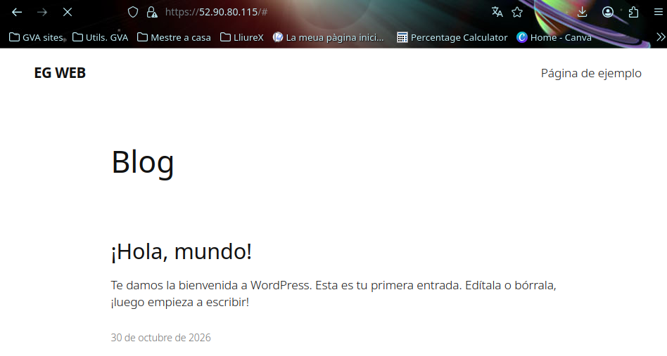
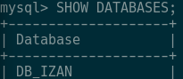
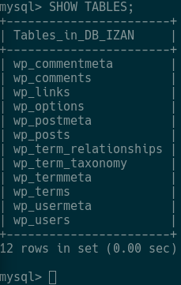
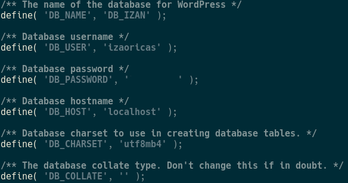
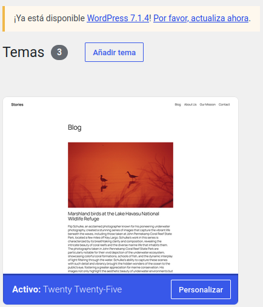
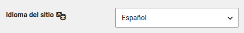
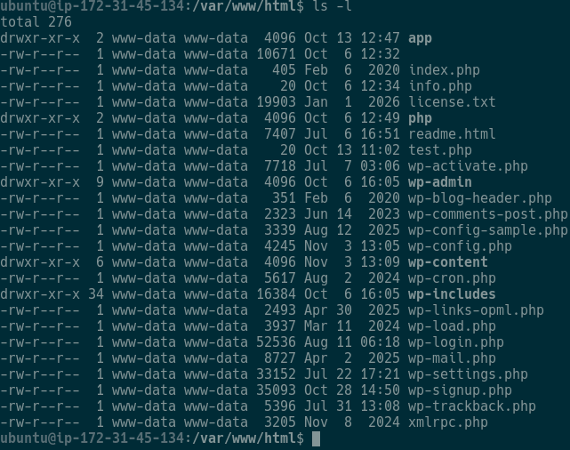
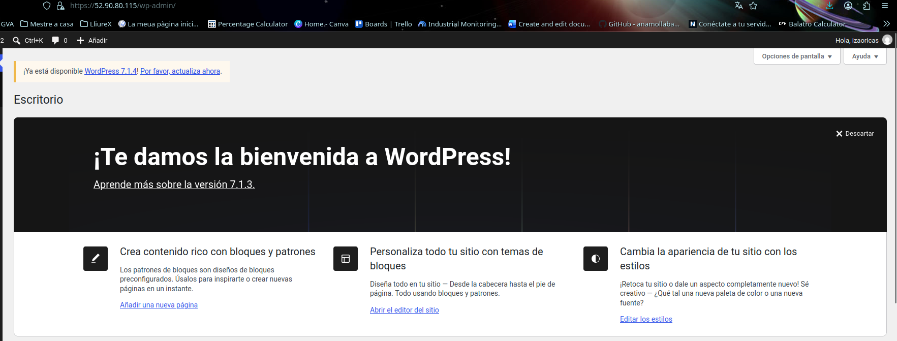

# E1 · Comparació de CMS
WORDPRESS: El gestor más popular del mundo; impulsa una gran parte de los sitios de internet por su flexibilidad, gran cantidad de plantillas y plugins.

MAGENTO (Adobe Commerce): Está diseñado específicamente para medianas y grandes empresas que manejan catálogos masivos de productos, múltiples tiendas o un volumen de ventas muy elevado.

# E2 · WordPress instal·lat i accessible

# E3 · Base de dades de WordPress

# E4 · Connexió WordPress → MySQL

# E5 · Configuració del portal

# E6 · Seguretat

# E7 · Proves de funcionament

