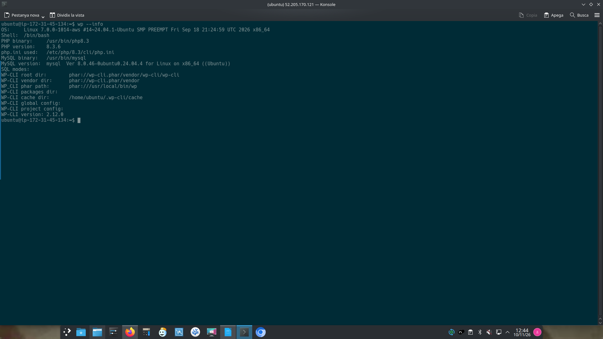
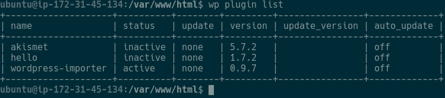
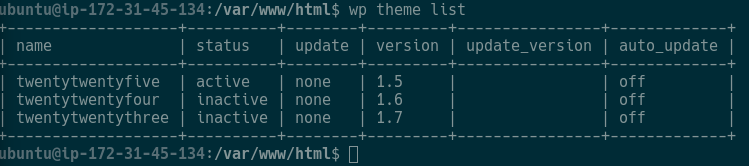
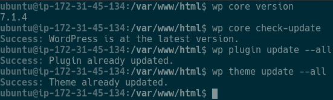
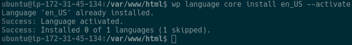
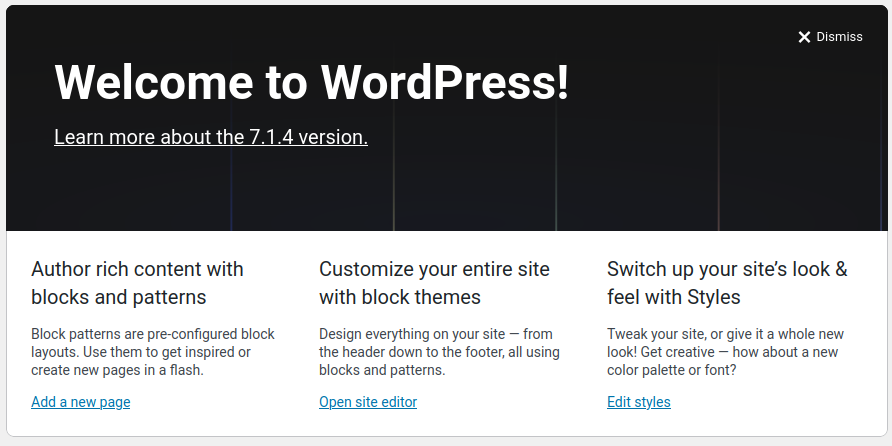
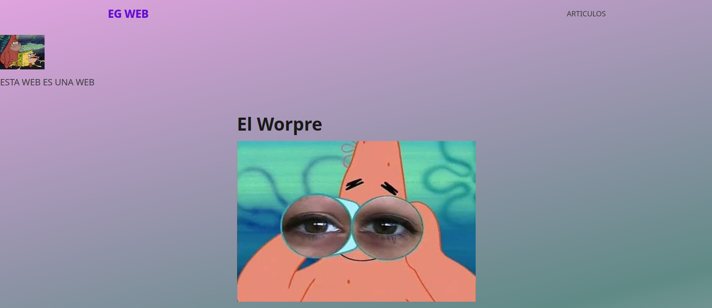

# E1 · WP-CLI instal·lat i operatiu

# E2 · Gestió de plugins amb WP-CLI

# E3 · Gestió de temes amb WP-CLI

# E4 · Actualitzacions de WordPress

# E5 · Configuració realitzada amb WP-CLI

# E6 · Portal final verificat

