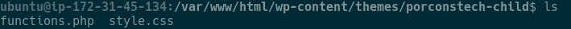
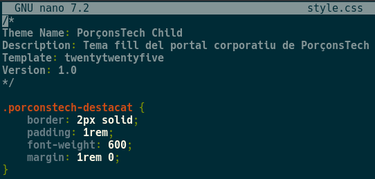
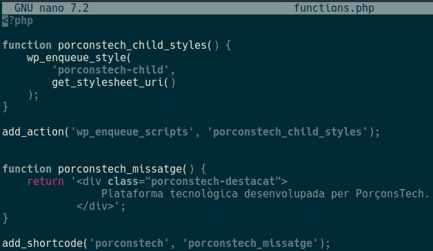
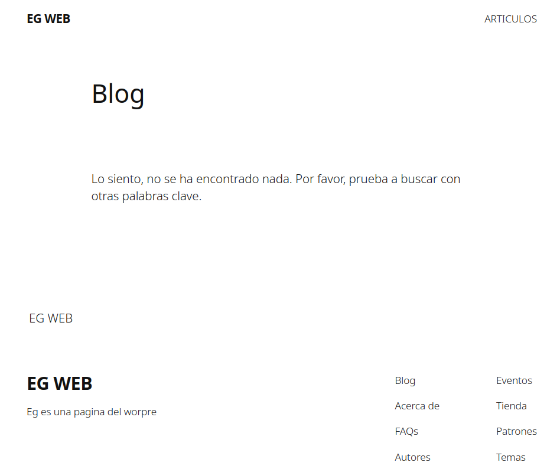
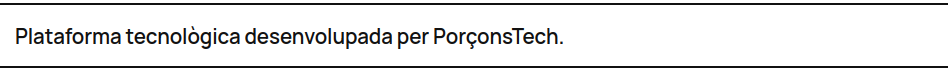
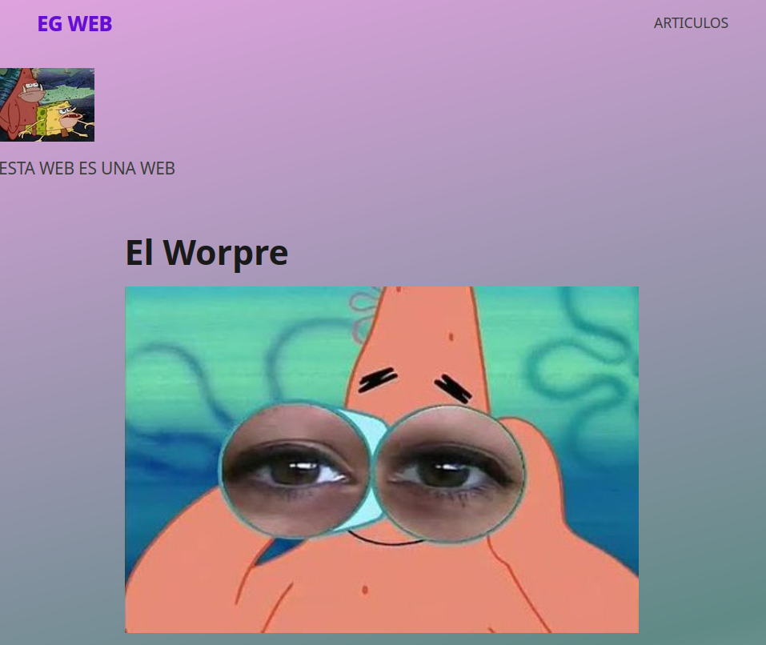
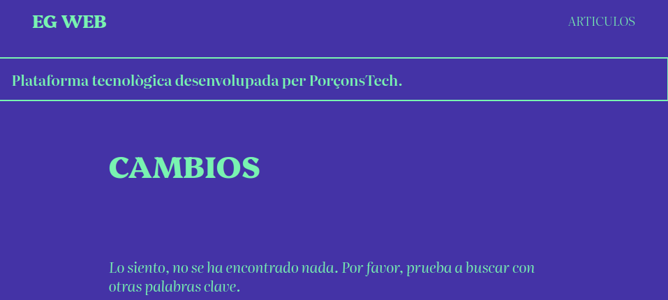

# E1 · Estructura de wp-content

# E2 · Tema pare identificat

# E3 · Directori porconstech-child

# E4 · Contingut principal de style.css

# E5 · Contingut principal de functions.php

# E6 · Tema fill actiu 

# E7 · Shortcode funcionant

# E8 · Modificació pròpia aplicada.
## Antes

## Después

