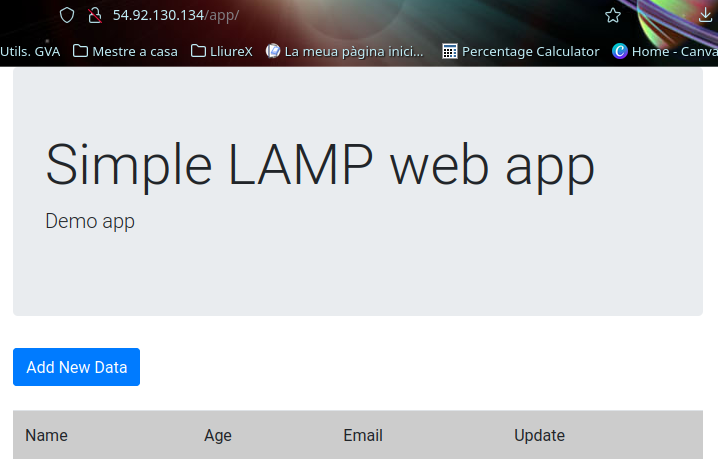
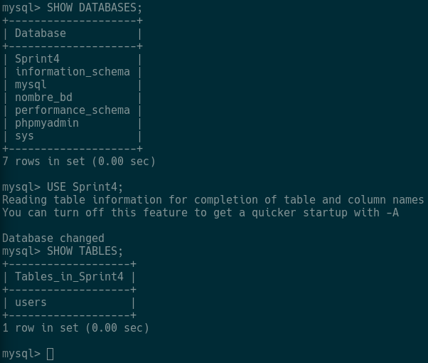
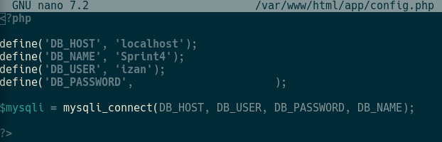

# EVIDENCIES ESPRINT 4
### E1 · Aplicación publicada

Explica en 2-4 líneas:
¿Qué camino sigue una petición desde el navegador hasta que recibes la respuesta?

El navegador envía una petición HTTP a Apache, el cual ejecuta el código PHP de /app. PHP consulta o modifica los datos en MySQL y devuelve el resultado a Apache, que envía la respuesta al navegador para mostrarla al usuario.

### E2 · Base de datos preparada

Explica en 2-4 líneas:
¿Por qué necesita la aplicación esta estructura de base de datos?

La aplicación necesita esta estructura de base de datos para almacenar y organizar la información que utiliza. Las tablas permiten guardar, consultar, crear, modificar y eliminar datos. 
### E3 · Configuración de la conexión

Explica en 2-4 líneas:
¿Por qué necesita la aplicación esta estructura de base de datos?

La aplicación necesita esta estructura de base de datos para almacenar y organizar la información en tablas. 
### E4 · CRUD verificado

ANTES

DESPUÉS

### Explica en 2-4 líneas:
¿Qué demuestra esta prueba sobre la relación entre PHP y MySQL?

Esta prueba demuestra que PHP se conecta correctamente con MySQL y puede insertar, consultar o modificar datos en la base de datos.
